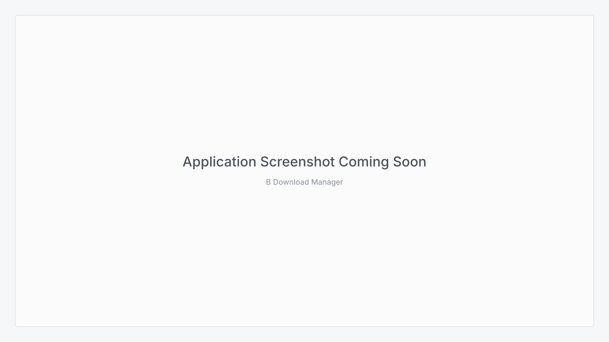

<div align="center">


# B Download Manager

**A multi-connection desktop download manager that resumes where it stopped.**

HTTP, HTTPS and FTP · Firefox and Chrome hand-off · tray resident

[](https://tauri.app/)
[](https://www.rust-lang.org/)
[](https://react.dev/)
[](https://www.typescriptlang.org/)
[](#requirements)

</div>

<p align="center">
  
</p>

## Overview

B Download Manager splits a file across multiple connections, writes each byte range to its own part file, and joins them when the last range lands. Pausing keeps the parts, closing the application keeps the manifest, and the next run continues from the bytes already on disk.

The engine is a standalone Rust crate with no window toolkit, tested headlessly against local HTTP and FTP servers. The desktop application is a thin Tauri 2 shell around it, with a Windows-style interface: a categories pane, a live download table, dedicated progress and completion windows, and a tray icon.

> **Status:** early development (`0.1.0`). Core downloads, resume, the tray, the progress and completion windows, the Site Grabber and both browser extensions work. Scheduling, media splitting and a few other features are not implemented yet. See [`PROGRESS.md`](./PROGRESS.md).

## Features

- **Segmented transfers:** one connection per byte range, up to 32, with per-site caps and an application-wide connection budget.
- **Resume, always:** a JSON manifest beside the part files survives pause, stop, a crash or an exit. Ranges that overlap or are out of order are never resumed from.
- **HTTP, HTTPS and FTP:** range requests with `Accept-Encoding: identity`, and FTP `REST` offsets with one data connection per range.
- **Proxy and speed control:** HTTP and SOCKS proxies for new downloads, plus a global cap and a per-download cap.
- **Browser hand-off:** a Firefox extension with a download button over videos, a Download all links window that collects a page's files into one reviewed batch, live download controls and settings, plus a Chrome/Edge build. Both use a versioned loopback bridge inside the application.
- **Site Grabber:** read one site on request, within a depth and page budget, and list the files its pages link to. It obeys `robots.txt`, pauses between requests and refuses private and metadata addresses on every hop; the files you tick go through the ordinary engine. See [`docs/SITE-GRABBER.md`](./docs/SITE-GRABBER.md).
- **A queue you can watch:** eight categories, a sortable table, search, selection, pause/stop/resume, context menus and properties.
- **Windows that fit the job:** a completion dialog with *Open file* and *Open folder*, and a progress window with per-connection detail and a speed limiter.
- **Tray resident:** closing the window hides it; the tray restores it, starts and stops the queue, and exits.
- **Themed and local:** one token file drives light, dark and system appearance, with eight bundled typefaces plus the system face. Nothing is fetched at runtime.

## Install

There are no packaged release artifacts in this repository yet; build the desktop application from source.

### Requirements

| Tool | Notes |
| --- | --- |
| [Node.js](https://nodejs.org/) | 20 or later |
| [Rust](https://rustup.rs/) | 1.77 or later, stable toolchain |
| **Windows** | [Microsoft C++ Build Tools](https://visualstudio.microsoft.com/visual-cpp-build-tools/) (*Desktop development with C++*) and WebView2, preinstalled on Windows 10/11 |
| **macOS** | Xcode Command Line Tools: `xcode-select --install` |
| **Linux** | WebKitGTK and the [Tauri prerequisites](https://tauri.app/start/prerequisites/) |

The window frame, tray icon and rounded corners are tuned for Windows. The engine and interface build on macOS and Linux, where window corners fall back to the square shape the content draws itself.

### Run from source

```bash
pnpm install
pnpm tauri dev
```

The first run compiles the Rust engine and can take a few minutes. Later starts are fast.

To run the frontend alone, knowing that every engine call will fail:

```bash
pnpm dev
```

### Build

```bash
pnpm tauri build
```

The installer and binary land in `src-tauri/target/release/bundle/`. Application icons are generated from the single brand source:

```bash
pnpm tauri icon src/assets/brand/logo.png
```

## Tech Stack

| Layer | Technology |
| --- | --- |
| Shell | [Tauri 2](https://tauri.app/): frameless window, custom title bar, tray icon, dialogs |
| Engine | [Rust](https://www.rust-lang.org/): [`idm-core`](./crates/idm-core), a headless crate with range planning, resume, limits, HTTP/HTTPS and an FTP client |
| Frontend | [React 19](https://react.dev/), [TypeScript 5.7](https://www.typescriptlang.org/), [Vite 6](https://vite.dev/) |
| UI | [shadcn/ui](https://ui.shadcn.com/) patterns, [Radix UI](https://www.radix-ui.com/), hand-drawn SVG artwork |
| Styling | [Tailwind CSS v4](https://tailwindcss.com/) with semantic tokens in [`src/index.css`](./src/index.css) |
| Persistence | Part files, a JSON manifest per download, and a session index for the download list |

## Development

### Project layout

```
crates/
  idm-core/           headless download engine
  idm-cli/            headless client for the engine
src-tauri/            Tauri commands, tray, windows, loopback bridge and the Site Grabber
src/                  React interface: shell, workspace, windows, settings, ui
site/                 Astro + Starlight site: landing page and docs (deployed to Vercel)
extension-firefox/    Firefox extension
browser-extension/    Chrome and Edge extension
docs/                 development guide
planning/             scope, engine specification, milestones and ADRs
```

### Checks

Run the build, the ten project gates and both Rust test suites before opening a pull request:

```bash
pnpm build

pnpm check:palette
pnpm check:fonts
pnpm check:selection
pnpm check:find
pnpm check:progress
pnpm check:add-dialog
pnpm check:recovery
pnpm check:tooltip
pnpm check:extension
pnpm check:grabber

cargo test --manifest-path crates/idm-core/Cargo.toml
cargo test --manifest-path src-tauri/Cargo.toml
```

The gates cover colour contrast, offered typefaces, the selection model, the Find bar, the progress window, the add dialog, the File Exists and Download Failed windows, tooltip placement, both browser extensions, and the Site Grabber's window helpers.

## How It Works

1. **Probe.** A one-byte range request (`Range: bytes=0-0`) reveals the size and proves the server honours ranges. A `200` answer means the file is fetched on one connection. Over FTP the size comes from `SIZE`.
2. **Segment.** The file is split into contiguous ranges targeting 16 MiB each, one per connection. The number of connections is one per 10 KB remaining, capped by the user's connection limit.
3. **Download.** Each connection requests its own range and writes to its own part file. Over FTP each range opens a data connection and uses `REST` followed by `RETR`. Requests identify themselves like a browser so servers that only serve browsers do not answer `403`.
4. **Verify.** The head of the file is compared with the head of every other range. A range holding the head of the file was not honoured, so its bytes are given back and the file is fetched on a single connection.
5. **Reassemble.** When the last range lands, the parts are joined in order and renamed onto the destination.
6. **Resume.** A crash-safe JSON manifest records what is done. The engine publishes state to the interface through `download://update`.

The reverse-engineered evidence behind these mechanics is in [`ANALYSIS.md`](./ANALYSIS.md), including an explicit list of what could not be established.

## Site Grabber

**Tasks → Run site grabber** reads one website and lists the files its pages link to. The crawl is breadth-first, stays on the start host (and its `www.` twin), and stops at the depth, page and file limits chosen in the window. It checks `robots.txt`, waits between pages, follows redirects one checked hop at a time, and refuses loopback, private-network and cloud-metadata destinations before each request and again at hand-over. Nothing is downloaded until a file is ticked: the selected files then enter the queue through the same `actions::start` path as every other download. The rules, defaults and limitations are in [`docs/SITE-GRABBER.md`](./docs/SITE-GRABBER.md).

## Browser Integration

The application runs a versioned JSON API on `127.0.0.1:27500`, reachable only from this machine. Requests must carry `X-BDM-Client: browser-extension`, and any `Origin` must be an extension origin. Neither build needs a native messaging host or a registry entry.

| Browser | Folder | What it adds |
| --- | --- | --- |
| Firefox | [`extension-firefox/`](./extension-firefox/README.md) | Right-click hand-off, download takeover, a download button over videos with live progress, a Download all links window, a compact popup and settings (MV3 event page) |
| Chrome / Edge | [`browser-extension/`](./browser-extension/README.md) | Right-click hand-off and download takeover over the same bridge contract |

To try the Firefox build, start the application, open `about:debugging#/runtime/this-firefox`, choose **Load Temporary Add-on…**, and select `extension-firefox/manifest.json`. A permanent install needs a signed `.xpi`; the extension README covers the AMO and Developer Edition routes.

## Documentation

| Document | Contents |
| --- | --- |
| [`ANALYSIS.md`](./ANALYSIS.md) | The reverse engineering: strings, addresses, pseudo-code, and what could not be established |
| [`docs/DEVELOPMENT.md`](./docs/DEVELOPMENT.md) | Conventions, module boundaries and the checks a change must pass |
| [`docs/SITE-GRABBER.md`](./docs/SITE-GRABBER.md) | The grabber's scope rules, defaults, reporting, tests and limitations |
| [`PROGRESS.md`](./PROGRESS.md) | What works, what is left, and the current gate status |
| [`planning/`](./planning/) | Scope, engine specification, UI direction, milestones, verification, risks and ADRs |

## Contributing

1. Fork the repository and create a branch (`git checkout -b feature/amazing-feature`).
2. Keep the engine free of window code; `idm-core` must stay testable without a desktop.
3. Run the checks listed under [Development](#development) before opening a pull request.
4. Use Conventional Commits (`feat:`, `fix:`, `docs:`, `refactor:`).

New colours belong in `src/index.css` first so the palette gate can verify them. Components read semantic tokens, never raw colour values.

## License

No license file has been added to this repository yet. Until one is chosen, the source is not licensed for reuse or redistribution. If you intend to use it, contact the author first.

<div align="center">

<sub>Built by <a href="https://github.com/bilals2008">Muhammad Bilal Hassan</a> · <a href="https://mbilalhassan.vercel.app/">mbilalhassan.vercel.app</a></sub>

</div>
