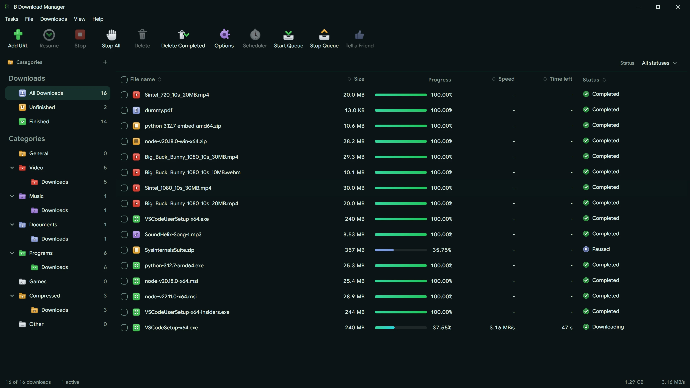

<div align="center">


# B Download Manager

**Pick up where it stopped.**

A multi-connection desktop download manager for HTTP, HTTPS, FTP, torrents and video.<br/>
Crash-safe resume, browser hand-off and a queue that stays out of the way.<br/>
No account · no cloud · no telemetry

[](https://github.com/bilals2008/b-download-manager/actions/workflows/ci.yml)
[](https://github.com/bilals2008/b-download-manager/releases/latest)
[](https://b-download-manager.vercel.app/)
[](https://tauri.app/)
[](https://www.rust-lang.org/)
[](https://react.dev/)
[](https://www.typescriptlang.org/)
[](LICENSE)

[Website](https://b-download-manager.vercel.app/) ·
[Download](https://github.com/bilals2008/b-download-manager/releases/latest) ·
[Firefox add-on](https://addons.mozilla.org/en-US/firefox/addon/b-download-manager/) ·
[What's new](WHATS_NEW.md) ·
[Report a bug](https://github.com/bilals2008/b-download-manager/issues)

</div>



## Overview

B Download Manager splits a file across multiple connections, writes each byte range to its own part file, and joins them when the last range lands. A crash-safe manifest records every finished range, so pausing, closing the app or losing power never costs you the bytes already on disk — the next run continues from exactly where it stopped.

Around that engine sits a full download workstation: torrent and video capture, a Firefox add-on that hands links straight to the app, a queue that runs on your schedule, and ten themes that repaint every window at once.

## Download

Grab the newest build from [**GitHub Releases**](https://github.com/bilals2008/b-download-manager/releases/latest):

| Platform | Package | Notes |
| --- | --- | --- |
| Windows 10 / 11 | `-setup.exe` installer | WebView2 required (bundled with Windows 11) |
| macOS 11+ | universal `.dmg` | One build for Intel and Apple Silicon |
| Linux | `.AppImage` or `.deb` | WebKitGTK prerequisites |

Installed apps update themselves in place: releases are signed, and the in-app updater verifies every signature before applying an update.

**Browser hand-off:** the [Firefox add-on](https://addons.mozilla.org/en-US/firefox/addon/b-download-manager/) is published on AMO. Chrome, Edge and Brave are on the way. The extension sends links, pictures and videos to the app over a loopback bridge on the same computer — Settings owns the capture switch, the file types and the site list.

## Features

**Download engine**
- Up to 32 connections per file, with per-site and application-wide caps
- Range-first HTTP/HTTPS requests, FTP `REST` offsets, one-connection fallback for servers that refuse ranges
- Crash-safe resume from a manifest kept beside the part files
- Global and per-download speed limits in KB/s or MB/s, applied across every open connection

**Torrents**
- Magnet links and `.torrent` files, with file selection before anything starts
- Progress, speed, peers and a live piece map in the torrent window
- Finished torrents keep seeding until your ratio or time limit, with a capped upload
- Trackerless magnets find peers through DHT; local peer discovery and optional router port mapping

**Video and media**
- HLS, MPEG-DASH and plain-file tracks captured with the quality list; tracks joined by a native MP4 remuxer — no re-encode
- YouTube downloads straight from the page at the quality you pick, via the optional `yt-dlp` helper or the in-house resolver
- Captions in every language the page offers, saved beside the video
- Sound-only saves as MP3, Opus or FLAC, keeping tags and cover art

**Queue and scheduling**
- Ordered queue with a simultaneous-download limit, categories and conflict dialogs
- Run the queue on chosen days and hours; it starts and stops by itself
- Power off only when the queue is empty — never mid-download
- Archives unpack automatically when they finish, asking for a password only when one is needed

**Around the web**
- Site Grabber: walk a page, filter by extension, size and depth, start only the files you want
- Google Drive: single files or whole folders, documents converted to PDF or Word, image boards saved as a folder of pictures
- Real-Debrid, AllDebrid and Premiumize unlock supported host links at your account's speed
- Encrypted DNS or NextDNS, per-adapter binding (Wi-Fi or Ethernet), live server and ping on every transfer

**Desktop fit**
- Ten themes plus Auto, following the system — one pick repaints every window, tray and browser panel included
- English, French, German and Arabic, with a fully mirrored right-to-left layout
- Toolbar packs, system tray with three mark styles, remembered window state
- An in-app What's New after each update, reopenable any time from Settings or Help

## Run from source

Requirements:

- Node.js 24 (the version CI builds with) and pnpm 12.15 (pinned by `packageManager`)
- Rust 1.77+ (stable) with the `rustfmt` and `clippy` components
- Windows: Microsoft C++ Build Tools + WebView2
- macOS: Xcode Command Line Tools
- Linux: WebKitGTK + Tauri prerequisites

```bash
pnpm install
pnpm tauri dev
```

## Build

```bash
pnpm tauri build                            # the default bundle for this OS
pnpm tauri build --bundles nsis             # Windows installer
pnpm tauri build --bundles deb,appimage     # Linux packages
pnpm tauri build --target universal-apple-darwin --bundles app,dmg   # macOS
```

Bundles land in `target/release/bundle/`. The installer ships no video tool; the optional YouTube helper is downloaded on demand and checked before it runs.

Release builds are signed for the in-app updater. The signing key and the rotation procedure are documented in [docs/RELEASES.md](docs/RELEASES.md). The workflow publishes a **draft** release that a person reviews and publishes by hand; installed apps never see a draft.

## Tests and checks

```bash
cargo test --workspace          # the app and the engine crate
pnpm test                       # frontend unit tests (Vitest)
pnpm check:all                  # every self-check script, including the release contract
pnpm verify                     # check:all + typecheck + unit tests, what to run before pushing
```

CI runs the same commands on every pull request, adds a Windows leg for the `cfg(windows)` code, lint-checks the whole workspace, and builds a signed production bundle on every push to `main`. The release workflow runs the full gate on the tag, builds the draft, and verifies every signature and `latest.json` against the key baked into the app before a person publishes it.

## Tech stack

| Layer | Technology |
| --- | --- |
| Shell | Tauri 2 |
| Engine | Rust workspace (`crates/`), including the download core, torrent and debrid crates |
| Frontend | React 19, TypeScript 5.7, Vite 6 |
| Styling | Tailwind CSS v4 with semantic tokens in `src/index.css` |
| Website | [b-download-manager.vercel.app](https://b-download-manager.vercel.app/) — Astro, source in [`site/`](site/) |

## Documentation

| Document | What it covers |
| --- | --- |
| [WHATS_NEW.md](WHATS_NEW.md) | Reader-facing release notes, newest first |
| [CHANGELOG.md](CHANGELOG.md) | Full change history |
| [docs/DEVELOPMENT.md](docs/DEVELOPMENT.md) | Project layout, conventions and daily workflow |
| [docs/RELEASES.md](docs/RELEASES.md) | Release, installer, signing and update procedure |
| [docs/TOOLBARS.md](docs/TOOLBARS.md) | Toolbar pack format |
| [docs/SITE-GRABBER.md](docs/SITE-GRABBER.md) | Site Grabber behaviour and filters |
| [CONTRIBUTING.md](CONTRIBUTING.md) | How to contribute |
| [SECURITY.md](SECURITY.md) | Reporting vulnerabilities privately |

## License

Released under the [MIT License](LICENSE). Contributions are accepted under the same terms; see [CONTRIBUTING.md](CONTRIBUTING.md) and [CODE_OF_CONDUCT.md](CODE_OF_CONDUCT.md). Please report vulnerabilities privately as described in [SECURITY.md](SECURITY.md).

<div align="center">

<sub>Built by <a href="https://github.com/bilals2008">Muhammad Bilal Hassan</a> · <a href="https://mbilalhassan.vercel.app/">mbilalhassan.vercel.app</a></sub>

</div>
